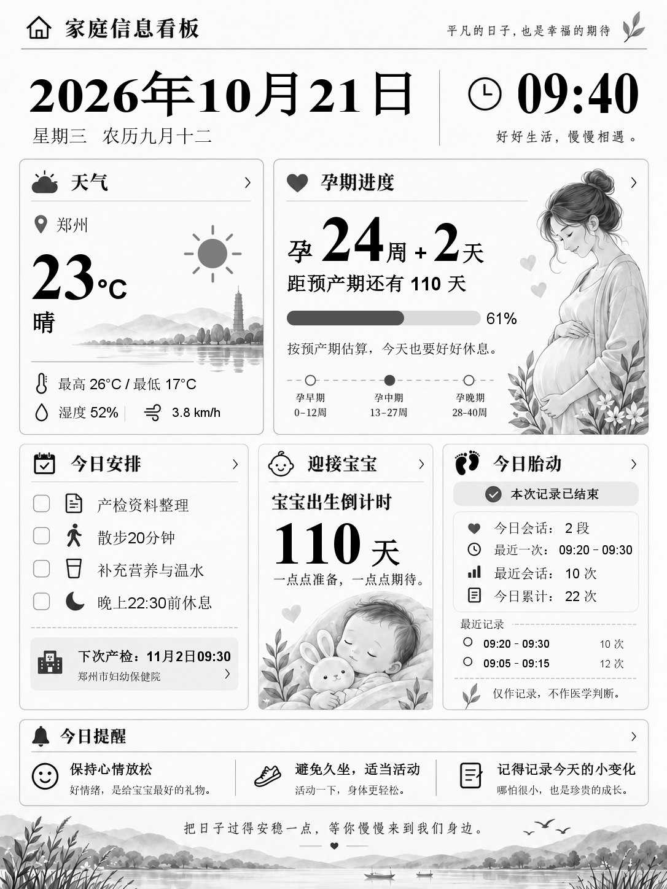

# Kindle Home Dashboard · Kindle 家庭信息看板

把闲置 Kindle 变成家庭信息屏：日期、农历、天气、孕周、今日安排、胎动记录和自定义寄语。手机修改内容，Kindle 自动更新；支持横竖屏、本地时钟、电量显示、点击房子返回主页，以及定时休眠。

Java 17 + Spring Boot + 原生 HTML/CSS/JS + 本地 JSON + Java2D。一个 JAR 提供管理页面、API 和灰度图片，无需 Node 或数据库。Kindle 上运行 Shell + FBInk，不需要 Java 或 Python。



[横版演示](docs/dashboard-landscape-example.png)

## 先确认设备与环境

| 项目 | 要求 |
| --- | --- |
| Kindle | 当前客户端针对 **Paperwhite 4（PW4），物理屏幕 1072 × 1448**；其他型号尚未适配 |
| 越狱 | 需要 KUAL、SSH 工具、FBInk；越狱方法取决于具体型号和固件 |
| 服务器 | 可持续运行的电脑、NAS 或 Linux 主机，Java 17、中文字体 |
| 网络 | 入门建议 Kindle、手机、服务器连接同一个可信家庭 Wi-Fi |
| 操作 | 需要复制文件、编辑配置、执行 SSH 命令 |

**服务端没有内置登录，不要将 8080 映射到公网。** 公网使用参阅 [Nginx 认证部署](deploy/nginx/README.md)。胎动功能只作手动记录，不提供医学判断。

## 从零安装顺序

1. 按下文启动服务器，先在电脑和手机上看到看板。
2. 按 [Kindle 安装与联网指南](deploy/kindle/README.md) 确认型号、固件、越狱，安装 KUAL/MRPI。
3. 按设备指南连接 Wi-Fi，安装 USBNetwork/USBNetLite，测试 SSH。
4. 安装本项目客户端，填写自己的服务器地址，补齐 FBInk、evtest。
5. 检查后进入看板，验证内容更新、返回主页和休眠唤醒。

**设备完整步骤：[越狱 → Wi-Fi/USB Network → SSH → 安装看板 → 排错与卸载](deploy/kindle/README.md)。**

## 文件在哪里

- [01-服务端](01-服务端/文件说明.md)：运行 JAR 的方法。
- [02-Kindle客户端](02-Kindle客户端/文件说明.md)：复制到 Kindle 的文件及用途。
- [根目录文件说明](文件说明.md)：源码、配置和文档的作用。

## 启动服务器

### 使用服务端文件夹

仓库根目录放置本 README 和项目源码；`01-服务端`、`02-Kindle客户端` 分别存放可运行程序和设备文件，每处都有中文文件说明。使用 `01-服务端/kindle-home-dashboard.jar` 启动服务。发布者整理步骤见 [分享与发布指南](docs/PUBLISHING.md)。运行只需 Java 17，自行编译另需 Maven 3.6.3+。

把 JAR 放进独立目录，在该目录打开终端：

```sh
java -version
java -jar kindle-home-dashboard.jar
```

打开 [http://127.0.0.1:8080](http://127.0.0.1:8080)。首次运行在**当前工作目录**生成 `data/`，包括设置、家庭记录和缓存图片。预产期初始为空，请自行填写。

### 允许手机和 Kindle 访问

Ctrl+C 停止刚才的进程，仍在同一目录启动：

```sh
java -jar kindle-home-dashboard.jar --server.address=0.0.0.0 --server.port=8080
```

Windows 执行 `ipconfig`，找到当前联网适配器的 IPv4，例如 `192.168.1.100`。手机访问 `http://192.168.1.100:8080`，Kindle 也使用这个地址。不能填写 `127.0.0.1`、`localhost` 或 `0.0.0.0`，它们不是供其他设备访问的服务器地址。

Windows 使用专用家庭网络，防火墙仅允许 Java/TCP 8080 从可信家庭网段访问。建议路由器为服务器保留 DHCP 地址，避免重启后 IP 改变。不要使用隔离设备的访客 Wi-Fi。电脑关机或休眠会停止更新，Kindle 保留缓存画面。

Linux 安装运行环境，例如 Debian/Ubuntu：

```sh
sudo apt-get update
sudo apt-get install openjdk-17-jre-headless fonts-noto-cjk
mkdir -p ~/kindle-dashboard
cd ~/kindle-dashboard
# 把 JAR 上传至此，再运行上面的 java -jar 命令。
```

首次用前台终端验证，长期运行交给自己的服务管理器，固定工作目录和数据目录。

### 从源码构建

在含 `pom.xml` 的目录执行。`java -version`、`mvn -version` 都应使用 Java 17；首次构建需要联网下载依赖。

```sh
mvn clean package
java -jar target/kindle-home-dashboard-0.1.0.jar --server.address=0.0.0.0
```

Windows 如默认 Java 不对，可在当前 PowerShell 设置实际路径：

```powershell
$env:JAVA_HOME = 'C:\实际路径\jdk-17'
$env:Path = "$env:JAVA_HOME\bin;C:\实际路径\apache-maven\bin;$env:Path"
mvn clean package
```

## 设置与日常使用

1. 在“设置”填写城市、经纬度、预产期、时区（建议 `Asia/Shanghai`）。
2. PW4 竖版 **1072 × 1448**，横版 **1448 × 1072**；保存成功后，Kindle 下次联网自动切换。客户端物理输出固定 1072 × 1448，不代表其他分辨率设备兼容。
3. 在“日常记录”维护安排和胎动计数，在“图中文字”修改产检和寄语。插画、卡片位置固定，不支持拖动排版。
4. 图片最多显示四条今日安排、两段最近胎动会话，完整记录仍保存在管理页。

服务端按北京时间整点、半点重绘，保存内容也会重绘。天气来自 [Open-Meteo](https://open-meteo.com/)（[CC BY 4.0](https://creativecommons.org/licenses/by/4.0/)），失败时显示不可用或上次成功缓存，不伪造实时数据。

| 状态 | 当前客户端行为（北京时间） |
| --- | --- |
| 插电，包括充满 | 每分钟本地时钟，每 30 秒检查网络，保持唤醒 |
| 电池 06:30–23:30 | 每 10 分钟更新时钟/检查网络，任务之间进入 RAM 休眠 |
| 电池 23:30–06:30 | 每小时快照和联网，其余时间休眠 |
| 手动进入或电源键唤醒 | 约 120 秒交互时间，之后回到自动策略 |

电量百分比只作显示，不参与分档。自动电池模式关闭前光；交互及退出恢复此前亮度。断网保留缓存画面。休眠时显示的是快照时间；返回主页前先短按电源键，再点房子。详见 [省电说明](deploy/kindle/HYBRID_POWER.md)。

客户端来自 PW4 实机流程；**本次整理后的新机安装流程尚未在第二台全新设备验证**。不同固件的触摸、RTC、系统进程和网络工具可能不同，不承诺通用适配或固定续航天数。

## 配置与备份

| 环境变量 | 默认值 | 用途 |
| --- | --- | --- |
| `SERVER_ADDRESS` | `127.0.0.1` | 监听地址 |
| `SERVER_PORT` | `8080` | 端口 |
| `BOARD_DATA_DIR` | `./data` | 数据和生成图片目录 |
| `BOARD_FONT_PATH` | 空 | 可选中文 TTF/OTF 字体绝对路径 |

Windows 优先使用系统宋体；Linux 可安装 Noto CJK。缺少中文字体时会报告渲染错误。字体文件不随项目分发。农历使用 [lunar-java](https://github.com/6tail/lunar-java)。

备份/恢复前先停止服务，再复制/替换整个 `data/`。升级前备份 JAR 和数据，替换 JAR 后保持启动工作目录、端口、字体与数据路径不变。一个数据目录只供一个进程使用。JSON 损坏时保留原文件及 `.corrupt-*` 备份并拒绝启动，应从备份恢复。

Kindle 升级前执行 `sh /mnt/us/extensions/kindle-dashboard/control.sh home`，备份扩展目录，再覆盖新客户端；保留自己的 `server-url.txt` 和 `bin/`。

## 目录与接口

```text
src/                   服务端、管理页、底图与测试
deploy/kindle/        Kindle 脚本、KUAL 菜单、配置示例和设备教程
deploy/nginx/         可选公网 HTTPS + Basic Auth
scripts/               图块生成与分享文件夹生成
docs/                 演示图、接口与发布指南
docs/history/         历史记录，不作为当前安装步骤
share/                 本地生成的 GitHub 上传目录（忽略，不提交）
data/、dist/data/       家庭数据（忽略，不提交）
.kindle-maintenance/    私人维护与备份（忽略，不提交）
```

常用接口：`/api/health`、`/api/version`、`/api/image`、`/api/kindle/frame`。设备依赖版本和 frame 两个接口，frame 返回清单、整图、时钟与电量背景 ZIP。普通 PNG 不能替代 frame 协议。详见 [接口速查](docs/API.md)。

## 常见问题

- **电脑能开，手机打不开**：检查监听地址、防火墙、服务器 IPv4、访客网络隔离。
- **Kindle 没更新**：检查服务器休眠、Wi-Fi 和 `server-url.txt`；电池模式需等待对应更新周期。
- **下载到 HTML/401**：进了登录页；公网代理必须精确放行设备只读接口。
- **中文空白/乱码**：安装中文字体或设置 `BOARD_FONT_PATH` 后重启。
- **点房子没反应**：先按电源键；再检查 PW4 型号及 evtest，必要时 SSH 执行 `control.sh home`。
- **SSH 断开**：电池模式会休眠，插电、唤醒后再连接。

## 第三方与素材

越狱、KUAL、MRPI、USBNetwork/USBNetLite 和 FBInk 由各自上游维护，下载与授权见设备指南。分享文件夹不捆绑这些第三方可执行文件。底图基于项目提供的参考图经 AI 编辑清理，运行时只用 Java2D 填字。目前未声明整体开源许可证；公开分享不等于授予任意再授权或商用权利，选择许可证前需要确认底图及其他素材来源。
